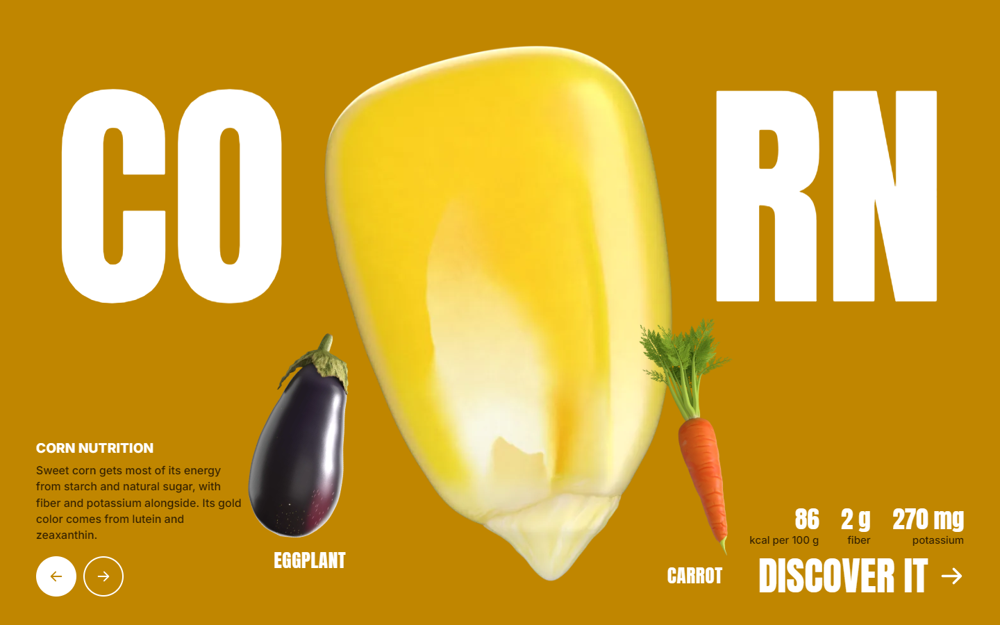

# Corn Land

[Live demo](https://ducquyen3.github.io/corn-land/)



A one-page website about three vegetables. Corn, eggplant and carrot float in 3D, and each one has its own background color and a short nutrition introduction.

Use the arrows to swap the vegetable in the center. The page changes color with it, and **Discover it** opens the full nutrition table. Every figure is per 100 g, raw, from [USDA FoodData Central](https://fdc.nal.usda.gov/).

## Run it

Open `index.html` in a browser. No install or build step is needed, and it also works straight from disk.

An internet connection is needed for three.js and the fonts, which load from CDNs. Without WebGL, the page shows still images of the models instead.

## What's in here

| Path | Contents |
| --- | --- |
| `index.html` | The website |
| `corn-land-cob.html` | An earlier version of the page, a Corn Land hero with a 3D cob |
| `assets/models/` | Full-quality models as `.glb` and `.blend` |
| `assets/models/web/` | The lighter models and still images the website loads |
| `assets/` | Photos and video used by `corn-land-cob.html` |
| `tools/` | Scripts that build the models and load them into Blender |

## Built with

- [three.js](https://threejs.org/) 0.160.0 and plain HTML, CSS and JavaScript
- Anton and Inter from Google Fonts
- Node for building the models, and Blender for the `.blend` scenes and still images

## Rebuild the models

The models are generated by code, and their textures are painted by the scripts. Building them needs only Node.

```bash
node tools/build-kernel.mjs
node tools/build-eggplant.mjs
node tools/build-carrot.mjs
```

To rebuild the lighter versions the website loads:

```bash
node tools/build-web-models.mjs
```

Run these from the project root. The usage for the Blender scripts is at the top of `tools/kernel-to-blender.py` and `tools/produce-to-blender.py`.

## Credits and license

Nutrition data comes from USDA FoodData Central: [corn](https://fdc.nal.usda.gov/food-details/169998/nutrients), [eggplant](https://fdc.nal.usda.gov/food-details/169228/nutrients) and [carrot](https://fdc.nal.usda.gov/food-details/170393/nutrients).

The photos and video in `assets/` belong to their creators and keep their own licenses (CC BY-SA 4.0, CC BY 2.0 and CC0). `assets/credits.json` lists the creator, license and source of each file.

This project has no license of its own yet, so all other rights are reserved.
